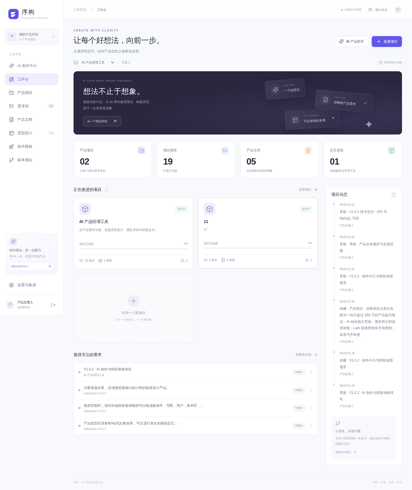
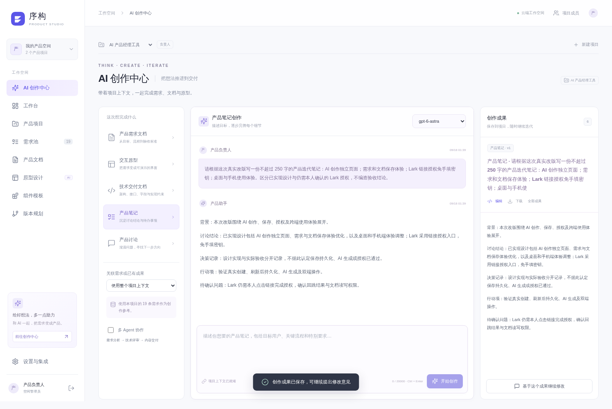
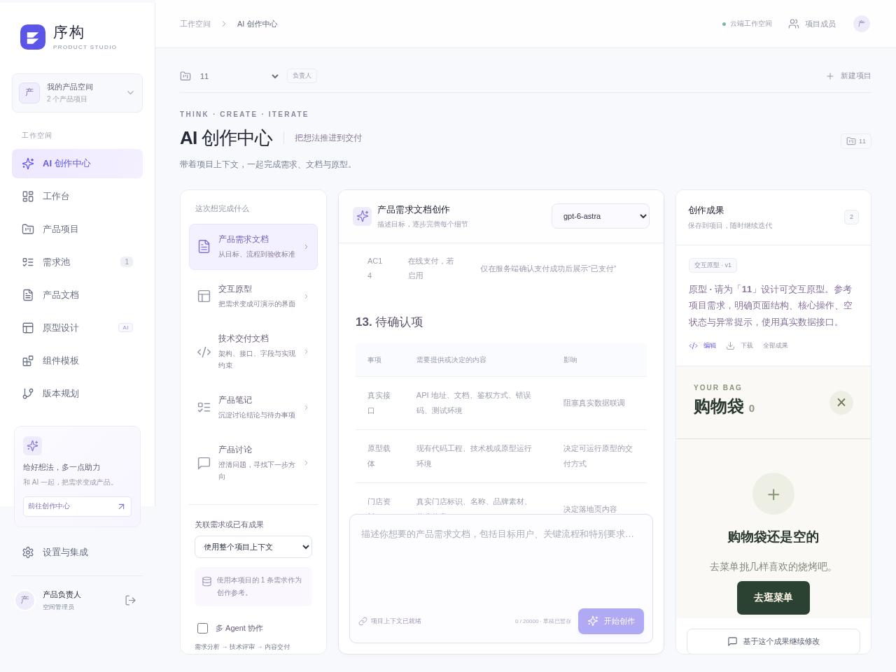

# 序构 · Product Studio

正式业务应用：Node.js 22 + NestJS 11 + Vue 3 + MySQL。

序构是一套面向产品经理和业务团队的 AI 产品设计工作台，用于管理项目需求、生成和编辑 PRD、组织原型、预览交互成果并连接飞书资料。它把需求分析、文档、原型和交付过程集中在同一个工作空间中。

## 项目亮点

- 项目与需求统一管理，支持 AI 创作中心和文档编辑。
- 原型源码、离线预览与数据快照一体化导出。
- 独立身份验证、配置加密和项目数据隔离。
- 支持飞书授权与资料接入，保留人工核对边界。

## 联系方式

- 微信：`charlesyin6015`

## 产品预览

> 以下截图为产品演示项目，仅用于说明工作流和界面能力。

### 产品工作台

### AI 创作中心

### 交互原型预览

## 目录
- server/src：身份验证、项目服务、集成与隔离原型编译。
- server/schema.sql：仅创建 pm_ 前缀新表；不删除已有数据。
- web/src：Vue 工作台。
- 产品设计需求文档：原始 instruction、产品总需求及同步规范。
- scripts：部署校验与浏览器验证。

## 运行
安装 Node.js 22，执行 `npm ci`。复制 `.env.example` 为 `.env` 并配置；`ENCRYPTION_KEY` 为 32 字节随机十六进制，创建后必须备份，不能随意更换。执行 `npm run build` 后使用 `npm start` 启动。
当前环境 Node 位于 /opt/laosiji-runtime/node-v22.16.0-linux-x64/bin。

首次启动生成管理员随机密码并写入权限为 0600 的 .access-admin。不会复用服务器或数据库密码。首次初始化仅导入真实 instruction 项目与需求。

## 部署
systemd 单元 /etc/systemd/system/product-studio.service，以 www 身份运行，监听 127.0.0.1:3010。
Nginx 配置 /www/server/panel/vhost/nginx/product-studio.conf，当前入口 http://154.40.47.111:8080，80 端口自动跳转至 8080。对外使用 Nginx 8080 端口，NestJS 3010 仍仅监听回环地址。
构建后 systemctl restart product-studio；日志 journalctl -u product-studio。

### 首次部署步骤

1. 安装 Node.js 22、MySQL 和 Nginx，并创建独立数据库与低权限数据库账号。
2. 执行 `npm ci`，复制并填写 `.env`；生成和离线备份 `ENCRYPTION_KEY`。
3. 按 `server/schema.sql` 初始化空库，确认不会覆盖其他项目数据。
4. 运行 `npm run typecheck` 和 `npm run build`，确认前后端均构建成功。
5. 使用 systemd 启动 `npm start`，由 Nginx 反向代理到 `127.0.0.1:3010` 并配置 HTTPS。
6. 首次登录后立即保存并修改管理员随机密码，再执行浏览器验证脚本。

更新前备份数据库和 `.env`，先在候选目录构建并验证，再重启服务。出现异常时恢复上一版本代码和对应数据库备份，切勿更换已有 `ENCRYPTION_KEY`。

## 验证与运行限制
浏览器验证：node scripts/browser-check.cjs，需要已安装的 Playwright Chromium；截图和报告置于 artifacts（不公开）。
项目无默认 AI 模型或第三方授权；在设置中配置真实凭据后才能使用对应外部能力。
原型导出含源码、离线视觉预览和数据快照。MySQL 交互依赖工作台数据桥接，独立交付需实现相同数据协议。
当前无文件附件上传、任意 npm 依赖安装、实时多人协同编辑、富文本 Lark 双向同步，不能将这些描述为已实现。

## V1.0.2
默认首页为 /studio AI 创作中心。Lark 设置改为官方注册链接/设备授权，无需手填应用密钥。首次需要本人在 Lark 确认专用应用与文档授权，凭据按本地用户独立加密保存。LEGACY_ORIGINS 可指定旧站点来源，用于 80 端口已有标签页的同源保存兼容。
